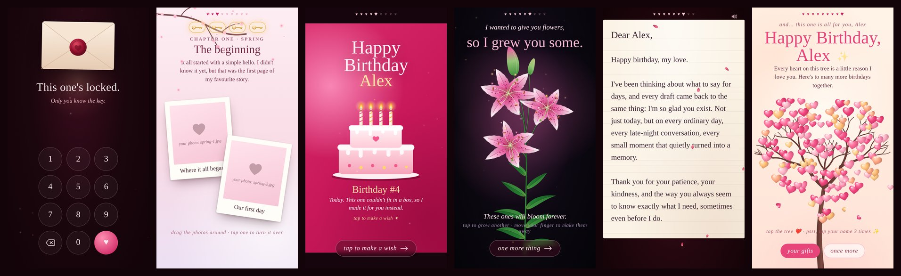

# Four Birthdays

An interactive birthday gift website. You edit one file, add your photos, and send the link.

**Live demo:** https://shaheer-sa.github.io/four-birthdays/ (code `142208`)



The site is a sequence of ten animated screens: a code lock, a rose made of words, your story in four seasons with your photos, a jar of reasons, birthday candles that can be blown out, a lily bouquet, a letter that writes itself, a heart of languages, and a heart tree with promise coupons at the end. It is designed for phones but works in any modern browser.

## Screens

| # | Screen | Description |
|---|---|---|
| 0 | Lock | Enter a code to open the gift. Wrong attempts show hints that get easier each time. |
| 1 | Cupid | Tap to shoot an arrow into the heart. |
| 2 | Word rose | A rose built from "I love you" in many languages and your nicknames. Tapping a word shows its language. |
| 3 | Our story | Four chapters (spring, monsoon, summer, autumn) with draggable photos. Each chapter hides a golden key. |
| 4 | Jar of reasons | Tap the jar or shake the phone to take out a reason. |
| 5 | Make a wish | Light four candles, each with a memory, then blow them out (microphone) or press and hold. |
| 6 | Lily bouquet | Lilies grow and sway with your finger. Tap to grow another. |
| 7 | The letter | The four keys unlock an envelope and the letter writes itself. |
| 8 | Heart of languages | A heart fills with "I love you" in about 100 languages, then turns into a 3D heart. |
| 9 | Heart tree | A tree of hearts, four promise coupons, and a hidden message. |

It also has background music (a generated piano by default, or your own song), sound effects, vibration, and a link preview image with app icons. The screen stays on while the gift is open, and a single accidental back swipe won't close it.

## Setup

### 1. Get a copy

Click **Use this template** and create a **private** repository, or download the ZIP from **Code > Download ZIP**.

### 2. Edit `config.js`

All the personal content is in `config.js`. Open it in any text editor and change the text inside the quotes. Keep the quotes and commas as they are.

| Setting | What it controls |
|---|---|
| `HER_NAME`, `MY_NAME` | The recipient's name and yours |
| `code` | Lock screen code (digits only, any length) |
| `lockFirst`, `lockHints`, `lockEmpty` | Messages for wrong or empty codes. Update the hints if you change the code. |
| `music` | `""` for the built-in piano, or a path like `"music/our-song.mp3"` |
| `whatsapp` | Your number with country code, digits only (e.g. `"15551234567"`). Shows a WhatsApp link when a coupon is redeemed. Leave `""` to hide it. |
| `lines` | Short lines of text on each screen |
| `nicknames` | Pet names that appear in the rose and the 3D heart |
| `chapters` | The story: titles, text, photo captions, the note on the back of each photo, and which photo hides the key |
| `reasons` | Reasons in the jar (any number) |
| `birthdays` | One memory for each of the four candles |
| `letter` | Greeting, paragraphs, an optional right-to-left line (Urdu, Arabic, Persian), sign-off and signature |
| `couponsIntro`, `coupons` | The four promise coupons |
| `secret` | Hidden message, shown after tapping the name three times on the last screen |

### 3. Add photos

Put eight photos in the `photos` folder with these exact names:

| File | Used in |
|---|---|
| `spring-1.jpg`, `spring-2.jpg` | Chapter 1, spring |
| `monsoon-1.jpg` | Chapter 2, the rainy window |
| `monsoon-2.jpg` | Chapter 2, photo |
| `summer-1.jpg`, `summer-2.jpg` | Chapter 3, summer |
| `autumn-1.jpg`, `autumn-2.jpg` | Chapter 4, autumn |

- File names are case-sensitive once the site is online, so `Spring-1.jpg` won't load.
- JPG resized to about 1200 to 1600 px on the long side keeps loading fast on phones.
- Convert iPhone HEIC photos to JPG first.
- A missing photo shows a placeholder with its file name.
- To use a different number of photos in a chapter, add or remove entries in `config.js`.

### 4. Add music (optional)

Put an MP3 in the `music` folder and set `music: "music/your-song.mp3"` in `config.js`. The song loops with a crossfade, so short clips work fine.

### 5. Test locally

Start a local server in the folder that contains `index.html`:

```bash
python -m http.server 8080
```

Then open http://localhost:8080. The VS Code Live Server extension also works.

The sample code is `142208`.

On localhost you can jump directly to a screen by adding its name to the URL and reloading: `#cupid`, `#rose`, `#story`, `#jar`, `#wish`, `#lily`, `#letter`, `#heart`, `#tree`. This doesn't work on the live site, so the lock can't be skipped there.

### 6. Deploy

**Netlify** (works with private repositories)

1. Log in at app.netlify.com. Sites dropped without an account are deleted after a while.
2. Go to **Add new site > Deploy manually** and drag in the folder.
3. Under **Site configuration > Change site name**, choose your address.
4. To update the site later, drag the folder in again under **Deploys**.

**GitHub Pages** (free accounts need a public repository)

1. Go to **Settings > Pages**, set the source to **Deploy from a branch**, choose `main` and `/ (root)`, and save.
2. The site will be available at `https://USERNAME.github.io/REPO-NAME/`.

Keep in mind that in a public repository your photos and letter are visible to everyone. Netlify with a private repository is the better choice for personal content.

### 7. Link preview

In `index.html`, replace the demo address `https://shaheer-sa.github.io/four-birthdays/` in the `og:` and `twitter:` tags with your own site address and deploy again. Shared links will then show a preview card. You can also change the `<title>`, `og-image.jpg` (1200x630) and the icons.

Before sending the link, open it on your own phone and go through every screen once.

## Privacy

- Anyone with the link can see everything on the site, including the photos, the letter and `config.js`. The lock screen is part of the experience, not real protection (the hints give the code away).
- Only share the link with the person it's meant for, and pick a site name that doesn't contain their full name.
- Use a private repository for personal photos and text. Git keeps the history, so deleting a file later does not remove it from earlier commits.
- Photos taken on phones often include GPS location in their metadata. Remove it before uploading.
- `robots.txt` and the `noindex` header ask search engines not to index the site.

## Notes

- Blowing out the candles uses the microphone. If permission is denied, pressing and holding the cake works instead.
- Shaking the phone takes a reason from the jar. Some iPhones ask for motion permission first.
- Redeeming a coupon asks for confirmation and is saved on the recipient's device.
- Some phrases are written for a male speaker or a female recipient (for example Hindi "करता हूँ", Urdu "کرتا ہوں", Hausa "Ina son ki"). They can be changed in `js/s-heart.js` and `js/s-rose.js`.
- The structure of four chapters, keys, candles and coupons is fixed. All of the text can be changed.
- An internet connection is needed for the fonts and animation libraries, which load from a CDN.

## Files

```
index.html            page structure and styles
config.js             all personal content
js/core.js            scene manager, particles, sound
js/boot.js            startup
js/s-*.js             one file per screen
photos/               your photos
music/                your song (optional)
og-image.jpg          link preview image
icon-*.png, manifest  app icons
_headers, robots.txt  hosting and indexing settings
```

## Credits

- [GSAP](https://gsap.com) for animation, loaded from cdnjs under its own license
- [canvas-confetti](https://github.com/catdad/canvas-confetti) (ISC)
- Fonts from [Google Fonts](https://fonts.google.com) (SIL Open Font License)

## License

[MIT](LICENSE)
